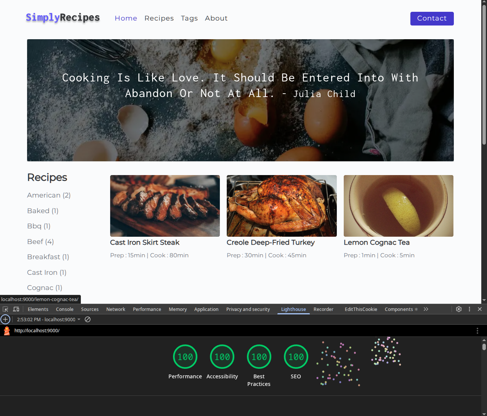

# Gatsby-Recipe-Page

Recipe website in React

## Introduction

Recipe-Page is a static recipe site built with Gatsby and React. Recipe content is managed in Contentful and rendered into pages at build time.

## Features

- Browse a collection of recipes
- Filter recipes by tag
- View recipe details: ingredients, instructions, tools, prep/cook time, and servings
- Contact form for questions or feedback

## Getting Started

To get started with Recipe-Page, follow these steps:

1. Clone the repository: `git clone https://github.com/milliorn/recipe-page.git`
2. Install dependencies: `npm install`
3. Start the development server: `npm run develop`
4. Open your browser and visit: `http://localhost:8000`

## Technologies Used

- Gatsby: Static site generator for building fast, optimized websites
- React: JavaScript library for building user interfaces
- Contentful: Headless CMS used to manage recipe content
- Styled Components: CSS-in-JS library for component styling
- Axios: Promise-based HTTP client for making API requests

## Contributing

Contributions to Recipe-Page are welcome! If you find a bug or have an idea for an enhancement, please open an issue or submit a pull request. Follow the [contribution guidelines](CONTRIBUTING.md) for more details.

## License

This project is licensed under the [MIT License](LICENSE).

## Acknowledgements

- The creators of React, Gatsby, and other open-source libraries used in this project
- The online community for their support and inspiration

## Contact

For any questions or inquiries, please open an Issue on this repo
